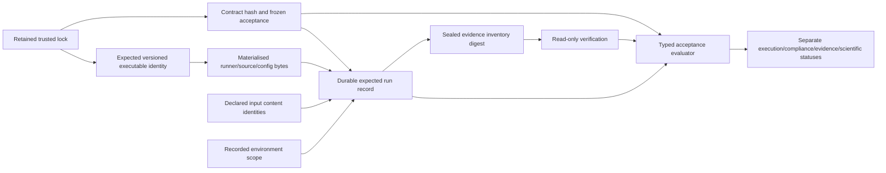

# EXPCON trust model

## Scope

Identity means matching bytes/semantics to an independently expected identity.
Integrity means detecting protected-content changes against that expectation.
Reproducibility requires sufficient effective inputs plus empirical replay under
predefined tolerances. A SHA-256 digest alone provides neither authenticity,
scientific validity nor numerical determinism. This is a trusted-host research
tool, not a sandbox for hostile Python. A malicious operator with write access to
both trust roots and evidence is outside the boundary; independent retention of
trust roots is necessary for stronger authenticity.

| Boundary | Classification | Condition |
|---|---|---|
| Experiment author | Conditionally trusted | Chooses scientific question/rules before freeze; may be mistaken |
| Frozen contract | Conditionally trusted | Canonical hash matches retained trusted lock |
| Contract lock | Trusted root | Operator protects/retains independently of transferred bundle |
| Source files | Untrusted | Materialised bytes checked against frozen identities |
| Execution bundle | Untrusted | Reconstructed bytes match expected lock/run identity |
| Runtime environment | Conditionally trusted | Declared software/input scope checked; host remains trusted |
| Backend adapter | Trusted implementation | Local tests; remote transport assumptions disclosed |
| External provider | Externally attested | API observations are not proof of executed mathematics |
| Runtime datasets | Untrusted | Declared content digests must match, including tree contents |
| Model/tokenizer | Untrusted | Explicit content identity required to be within verified boundary |
| Produced metrics | Untrusted observations | Never criteria or verdict authority |
| Produced artifacts | Untrusted | Content inventory and producer/run bindings checked |
| Evidence package | Untrusted | Inventory digest anchored independently to expected run |
| Scientific evaluator | Trusted implementation | Typed frozen rules, adversarial regression coverage |
| Agent/human operator | Conditionally trusted | Cannot override checks; protecting roots remains responsibility |

## Machine-testable invariants

- T01: produced thresholds/verdicts cannot alter frozen acceptance.
- T02: protected executable bytes reconstruct the expected bundle identity.
- T03: declared input file/tree content matches expected digests before launch.
- T04: evidence run/experiment/contract/bundle identities match expected run.
- T05: trusted required outputs exist and match the sealed artifact inventory.
- T06: missing/malformed/invalid evidence cannot yield SUPPORTED.
- T07: unsuccessful/unknown execution cannot yield SUPPORTED.
- T08: noncompliant/unknown contract cannot yield SUPPORTED.
- T09: submitted/pending/running remain nonterminal execution states.
- T10: verification/adjudication attempts preserve preceding results, including failures.
- T11: v1/v2 identity interpretation remains unchanged; stronger checks are explicit.
- T12: verification does not modify protected evidence.
- T13: untrusted relative paths cannot escape their declared roots, including symlinks.
- T14: operational records do not persist secret environment binding values.
- T15: declared stage dependencies determine execution order or are rejected.

## Reproducibility levels

1. Declared identity: intended inputs/configuration identified.
2. Verified execution inputs: actual executable and declared data bytes checked.
3. Environment consistency: relevant software/hardware recorded or enforced.
4. Empirical reproducibility: independent replay meets predefined tolerances.

Historical reproducibility.level values retain their old interpretation. These
assurance levels describe evidence, not a retroactive identity change.

## Exclusions and adversaries

Dynamic imports outside declared closure, undeclared network reads, host mutation
during execution, malicious experiment code, compromised provider/compiler/OS,
hardware nondeterminism and unmeasured library effects remain outside guarantees.
Content checks are admission-time checks, not OS-enforced immutability. Test
payload+checksum mutation, output substitution, deleted inputs, different run IDs,
forged verdicts, path/symlink escape, malformed manifests, duplicate transitions,
crash boundaries and secret persistence. Provider integration claims require
separate live validation and approval; local mocks cannot establish it.

## Implemented recovery scope

New opt-in bundle v3 binds materialised executable/config/transport payload. V1/v2
hash meanings remain unchanged. V2 materialised declared runners and source are
checked, but unbound notebook metadata is refused under strict admission. New
evidence v2 is sealed by manifest SHA-256 in the trusted run journal; every file
is inventoried, including hashes.json via the anchored manifest. Legacy unanchored
evidence cannot be silently promoted. Verification reads protected evidence only.

Input declarations may specify file SHA-256 or expcon-input-tree-v1 directory
SHA-256. The tree includes hidden files, relative paths, sizes and every regular
file digest; symlinks are refused. Index references outside that declared tree are
not automatically traversed. Missing input hashes are explicitly unverified.
Named nonsecret environment SHA-256 constraints can be enforced; credential
bindings are never frozen or serialized. Undeclared ambient environment is outside
identity. Admission checks inputs before run creation and again before launch.
These are time-of-check checks, not OS-enforced immutable mounts.

Local CPU preflight records the complete installed distribution inventory; an
explicit frozen distribution_versions map enforces equality when supplied. Direct
lock versions remain checked. GPU/TPU local attestation is not implemented and
constrained local accelerator execution is refused. CUDA/driver identities are
null in the CPU reference workflow, not inferred. No bitwise GPU claim is made.

## Regression-to-invariant map

| Invariant | Executable regression evidence |
|---|---|
| T01 acceptance authority | tests/recovery/test_adjudication.py output threshold/verdict and comparison/all cases |
| T02 executable binding | tests/recovery/test_integrity.py payload+checksum attack; test_bundle_versions.py |
| T03 input content | tests/recovery/test_input_closure.py file, tree and environment cases |
| T04 expected run | test_expected_run_identity_is_required |
| T05 required copies | test_required_output_substitution_is_detected; test_packaging_refuses_different_scientific_metric_copy |
| T06 missing evidence | Missing/invalid metric and tamper adjudication cases |
| T07/T08 upstream gates | Full failed execution/compliance/missing contract adjudication cases |
| T09 asynchronous state | Fake remote CLI pending/running/complete test and observation matrix |
| T10 retained attempts | Repeated CLI verification/adjudication and original-record preservation tests |
| T11 historical interpretation | Bundle v1/v2/v3 compatibility tests and traversal symlink exclusion |
| T12 read-only verification | test_verification_is_read_only and independent historical hashes |
| T13 path containment | Manifest, symlink, stage and invocation traversal cases |
| T14 secret handling | Context sentinel and fake timeout-output redaction tests |
| T15 dependency order | test_stage_dependencies_determine_order |
| T16 retained freeze root | tests/recovery/test_freeze_preservation.py missing/advanced state cases; exclusive lock publication |

Scientific observations are read only from the frozen evaluation.metrics_file
under outputs (default metrics.json). Convenience metric copies must agree;
aggregate filenames or output verdict strings are not evaluator selection rules.
Registration establishes content/metadata, not a verified causal DAG.
